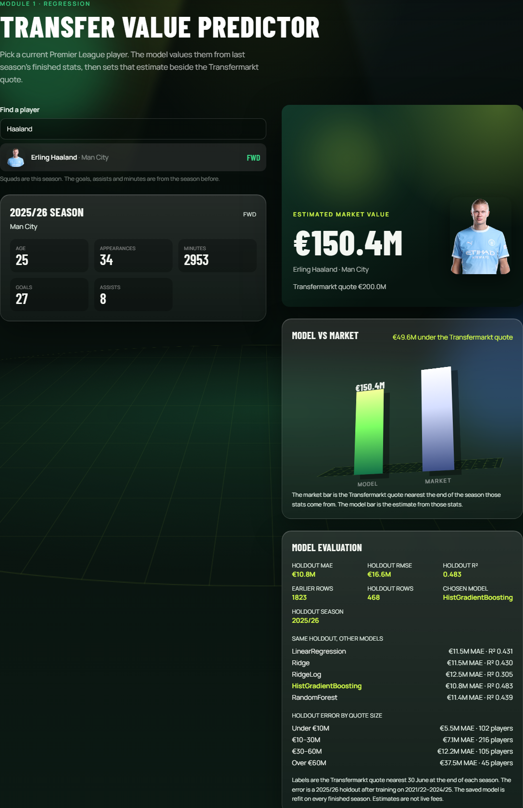
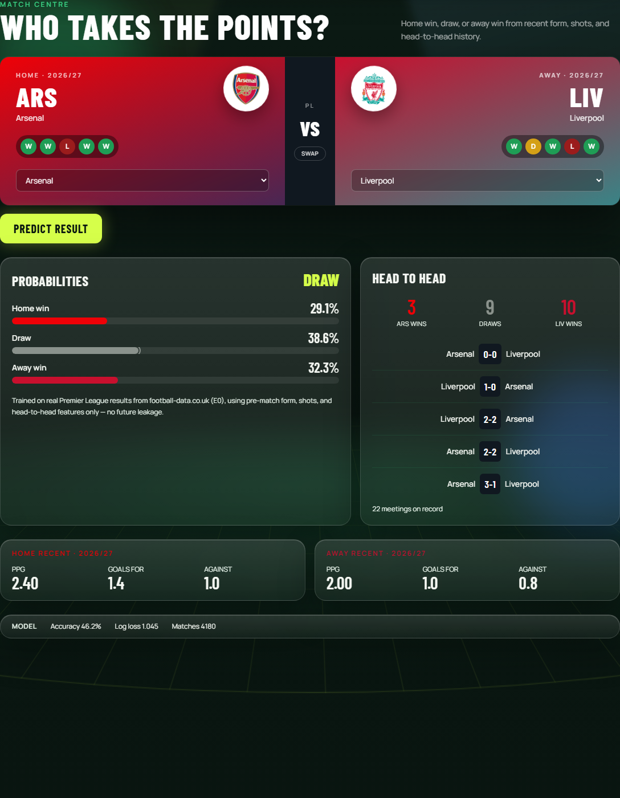
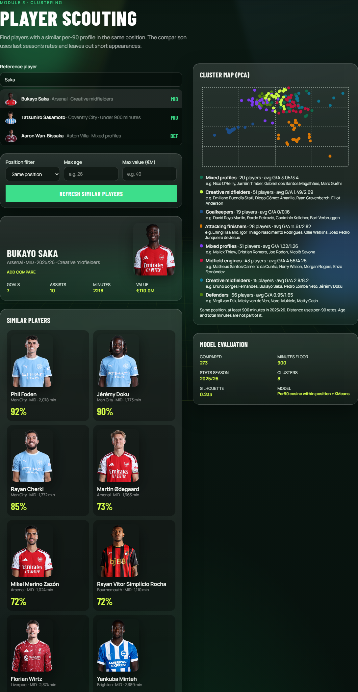

# FootyMetrics

Football intelligence platform for the Premier League: transfer valuation, match outcome prediction, and player scouting — one app, three ML modules.

## Current status

All three modules are live:

1. **Valuation** — FPL stats, dated Transfermarkt quotes, HistGradientBoosting  
2. **Match odds** — football-data.co.uk results, logistic regression  
3. **Scouting** — same-position per-90 similarity, with a 900-minute floor  


## Stack

| Layer | Tech |
|-------|------|
| Frontend | React, TypeScript, Tailwind, Vite, Recharts |
| Backend | Python, FastAPI |
| ML | scikit-learn, pandas, NumPy, joblib |
| Storage | CSV and joblib files. PostgreSQL is a Compose profile for later persistence work |

## Quick start (local, no Docker)

### 1. Python env + train model

```bash
python -m venv .venv
# Windows
.venv\Scripts\activate
# macOS/Linux
# source .venv/bin/activate

pip install -r backend/requirements.txt

# Real data (recommended)
python -m ml.training.ingest_football_data
python -m ml.training.train_match_outcome
python -m ml.training.ingest_fpl_valuations
python -m ml.training.train_valuation
python -m ml.training.train_scouting
```

### 2. Backend

```bash
uvicorn backend.app.main:app --reload --port 8000
```

API docs: http://localhost:8000/docs

### 3. Frontend

```bash
cd frontend
npm install
npm run dev
```

App: http://localhost:5173

### Docker

Train on this machine first so the CSV and joblib files exist, then:

```bash
docker compose up --build
```

App: http://localhost:5173  
API: http://localhost:8000/api/health

Compose bind-mounts `data/` and `ml/models/` read-only. The web container proxies `/api` to the API container. Health reports `"storage": "files"`. PostgreSQL is not part of that stack; start it only with `docker compose --profile postgres up` when working on a future database.

## Project layout

```
backend/     FastAPI app
frontend/    React UI
ml/          Training scripts + saved models
data/        Raw / processed datasets
```

## Portfolio







How the pieces connect is in [docs/ARCHITECTURE.md](docs/ARCHITECTURE.md). Holdout scores and the limits of each model are in [docs/EVALUATION.md](docs/EVALUATION.md). Where the rows come from is in [DATA.md](DATA.md).

There is no hosted URL in this repo. The demo is this app, run locally or with Docker. A shareable archive that omits `node_modules`, virtualenvs, and the bulk raw downloads:

```bash
python scripts/make_release.py
```

That writes `releases/FootyMetrics.zip`. The zip includes the joined CSV tables and the trained joblib files so the demo can start without rebuilding them.

## Data note

See [DATA.md](DATA.md). Default mode uses real PL match results (football-data.co.uk) and real player season stats (FPL) with Transfermarkt value labels where names match.

## Roadmap

- [x] Phase 0 scaffold  
- [x] Module 1 — Transfer value  
- [x] Module 2 — Match outcome  
- [x] Module 3 — Scouting / similarity  
- [x] Tests, file-backed Docker config, portfolio write-up  
- [ ] Hosted public demo  
